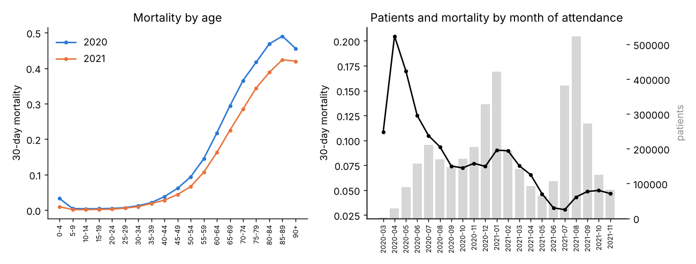
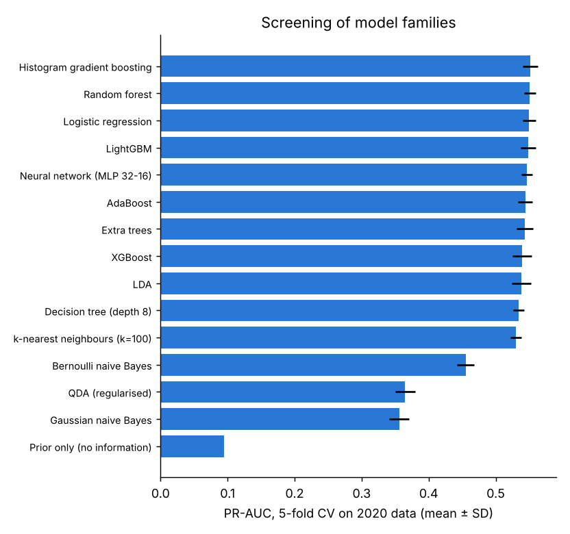
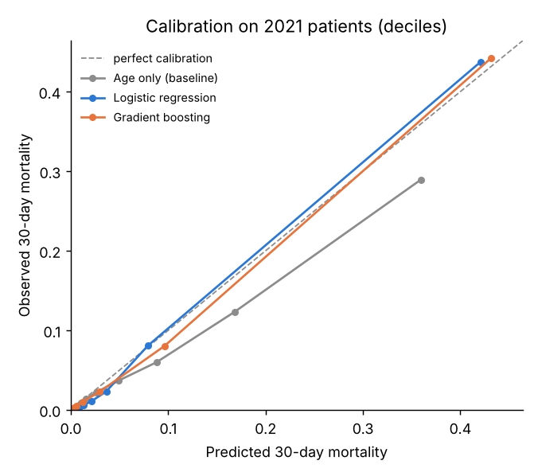
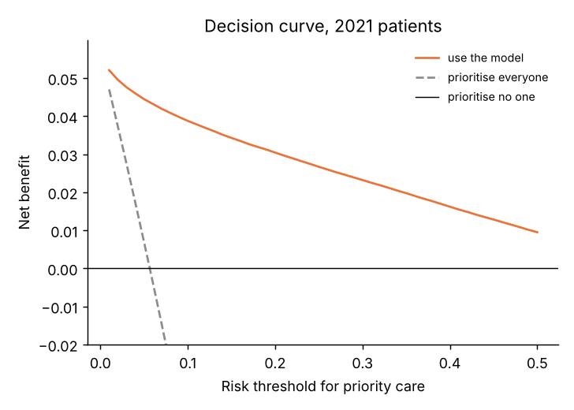
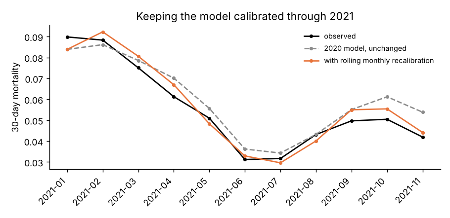
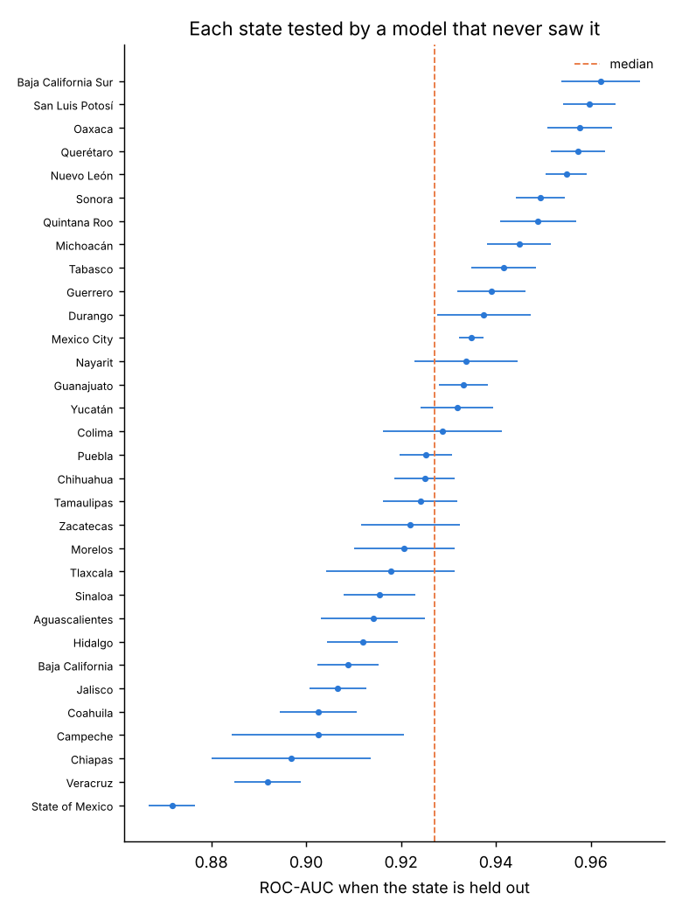
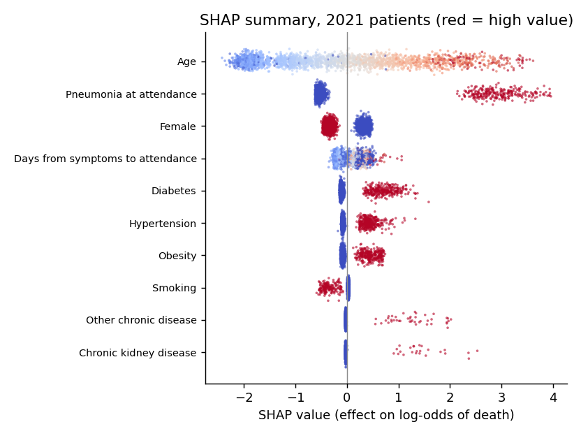
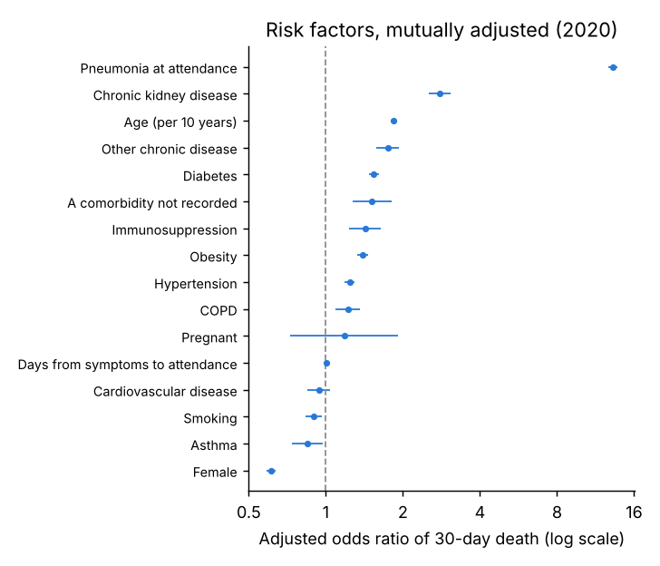
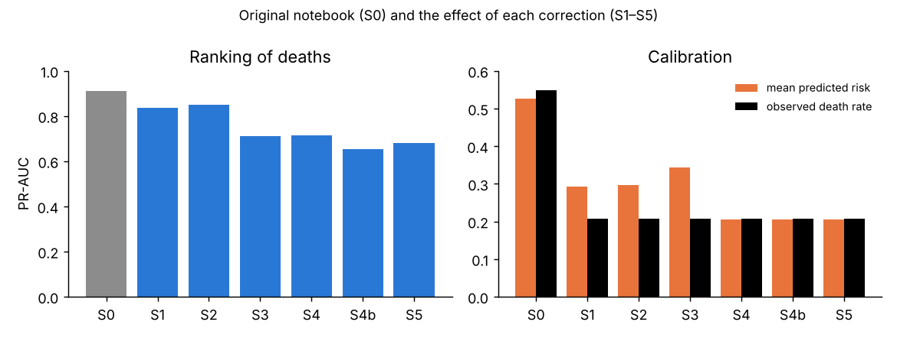

# COVID-19 Mortality Risk Model: prioritising patients at first attendance

[](https://github.com/Muneera-DSA/COVID19-Mortality-Risk/actions/workflows/ci.yml)

> 📓 **Walkthrough notebook:** [`notebooks/walkthrough.ipynb`](notebooks/walkthrough.ipynb) tells the full analysis story step by step, with every table and chart already shown. It reads the saved results, so it opens on GitHub and runs in seconds.

I built a **30-day mortality risk model for confirmed COVID-19 patients** on Mexico's official national surveillance records (12.7 million records, **3.92 million confirmed patients**). It scores each patient at first attendance, using only what is known at that moment (age, sex, pregnancy, chronic conditions, pneumonia, days since symptom onset), so a health unit can decide **who to prioritise for monitoring and beds**.

**What it achieves** (trained on 2020, tested on **2.41 million patients from 2021**, a later period with new variants and vaccination):

| | |
|---|---|
| Discrimination | **ROC-AUC 0.949** (95% CI 0.949–0.950), PR-AUC 0.546 at a 5.7% death rate (a random model scores 0.057) |
| Prioritisation | The **10% highest-risk patients include 78% of all deaths**; the top 20% include 92% |
| Calibration | 5.8% predicted vs 5.7% observed overall, ECE 0.004; a rolling monthly update keeps it on track |
| Transfer to unseen regions | Median ROC-AUC **0.927 across all 32 states**, each held out in turn (range 0.872–0.962) |
| Explainability | SHAP and adjusted odds ratios: age, pneumonia, male sex, delay since symptoms, diabetes, hypertension, obesity |

**How it was built:** data-quality and consistency tests on every field → EDA → a 15-model cross-validated screen (logistic regression to XGBoost and LightGBM) → tuned gradient boosting, required to beat an age-only baseline and logistic regression → temporal and state-held-out validation → leakage, class-imbalance and subgroup tests with Holm-corrected hypothesis tests → calibration, decision curves and monitoring → SHAP. Full output: [`reports/results.md`](reports/results.md), generated by the code; [`MODEL_CARD.md`](MODEL_CARD.md) for intended use and limits.

**Version 2 of my capstone project.** My capstone model reported 82% accuracy and ROC-AUC 0.90 on a 200,000-row extract. Re-running it showed those figures came from a distorted sample and post-triage variables, so I rebuilt it on the full national data with validation that rules both out. The [last section](#from-v1-to-v2-what-the-capstone-version-got-wrong) quantifies each fix.

### Further findings

| Question | Answer (official data, 3.92 million patients) |
|---|---|
| How much data? | 12.7 million official records → **3.92 million confirmed patients**: 1.51 million (2020) for training, 2.41 million (2021) for testing |
| Is the data reliable? | Every field is at least 99.1% complete; no codes outside the official catalogue; no outpatients recorded in ICU and no pregnant men. 307 impossible ages and 1,450 implausible dates were found and handled |
| Are its risk percentages trustworthy? | Yes, overall: 5.8% predicted vs 5.7% observed, ECE 0.004. But they drift between waves, which is why monthly recalibration is included |
| Does it work in states it never saw? | Median ROC-AUC 0.927 across the 32 states (range 0.872–0.962). Calibration varies by state, so local recalibration is needed |
| Did fixing class imbalance help? | **No.** Class weights, oversampling and SMOTE did not improve ranking, and all three destroyed calibration |
| How much would leakage have inflated it? | Adding hospitalisation, ICU and intubation: ROC-AUC 0.949 → 0.980, PR-AUC 0.546 → 0.686 |
| Did the complex model matter? | Barely. Gradient boosting beats logistic regression by 0.003 ROC-AUC. Eleven of the 15 model families screened score within 0.007 of each other |

---

## The model: built on national data, validated over time and across states

| | |
|---|---|
| **Data** | Mexico, Secretaría de Salud, open COVID-19 line list (SISVER), official files for 2020 and 2021 |
| **Population** | Laboratory/antigen-confirmed (code 3) or epidemiologically confirmed (code 1) COVID-19. Code 2 is excluded because it is assigned only to deaths |
| **Outcome** | Death within 30 days of first attendance. Patients need at least 30 days of follow-up before the file date |
| **Predictors** | Only what is known at first attendance: age, sex, pregnancy, 10 chronic conditions, pneumonia, days from symptoms to attendance, plus flags for missing values |
| **Never used as predictors** | Hospitalisation, ICU, intubation (they happen after the triage decision). They are used only in the leakage check |
| **Development** | Attended March–December 2020 |
| **Temporal test** | Attended January–November 2021 (later waves, Delta, vaccination). Never used for any choice |
| **Geographic test** | Internal-external cross-validation: each of the 32 states is held out in turn |
| **Data quality** | Completeness of every field, codes outside the official catalogue, cross-field consistency (e.g. outpatients recorded in ICU, pregnant men, symptoms after attendance), plausibility, duplicate records across files, and the 2020→2021 shift in every variable (standardised mean differences) |
| **EDA** | Mortality by age, sex within age, month, state, health sector, days since symptoms, number of conditions; crude odds ratios; correlation between conditions; missing-data patterns; hospital/ICU use by age |
| **Model screening** | 13–15 model families (logistic, LDA, QDA, naive Bayes, k-NN, decision tree, random forest, extra trees, AdaBoost, gradient boosting, neural network, XGBoost, LightGBM, plus a no-information baseline). All are scored by 5-fold cross-validation on 2020 data only: LazyPredict's idea, without its use of the test set |
| **Models** | Age only (baseline), then logistic regression (age spline), then gradient boosting, tuned. Each must beat the previous one |
| **Imbalance** | None, class weights, oversampling and SMOTE-NC are compared inside cross-validation folds only; a correction is kept only if it is significantly better |
| **Uncertainty** | DeLong CIs and tests for ROC-AUC; patient bootstrap for PR-AUC; corrected resampled t-test for CV comparisons; Holm correction |
| **Explainability** | SHAP for the chosen model (exact for logistic regression, TreeExplainer for gradient boosting, with a completeness check and a cross-check against the `shap` library), plus adjusted odds ratios. Grad-CAM does not apply: it is for image models |

### Hypotheses (Holm-corrected)

| # | Hypothesis |
|---|---|
| H1 | Triage features add to age alone |
| H2 | Gradient boosting beats logistic regression |
| H3a–c | Class weights / oversampling / SMOTE-NC improve PR-AUC |
| H4 | Calibration drifts between 2020 and 2021 |
| H5 | Post-triage variables inflate discrimination (leakage) |
| H6 | Discrimination differs between women and men |

### Results

Full tables and every figure: [`reports/results.md`](reports/results.md). 95% CIs: DeLong for ROC-AUC, bootstrap for PR-AUC.

**Data.**
- 12,698,741 records in the two official files.
- 4,074,247 confirmed patients after excluding the death-only code.
- 3,922,386 patients in the study after the age, date and follow-up rules: **1,511,556 for development (2020, 9.4% died within 30 days) and 2,410,830 for testing (2021, 5.7% died)**.

**Data quality** (4.09 million raw confirmed records):
- no field is missing in more than 0.9% of records;
- no code falls outside the official catalogue;
- no outpatient is recorded in ICU and no man is recorded as pregnant;
- 307 ages above 110 and 1,450 records with symptoms more than 30 days before attendance were found and handled.

**Data shift.** Between 2020 and 2021 the patients became younger (median 43 → 37), had pneumonia less often (15.3% → 8.9%), and died less often (9.4% → 5.7%). Because of this shift, testing on 2021 is a demanding test.



**Screening 15 model families** (5-fold CV on 2020 data only, the correct version of LazyPredict). The top 11 models all score ROC-AUC between 0.921 and 0.928, while naive Bayes and QDA lag behind. The signal is mostly captured by simple models.



**Imbalance (H3).** Class weights, oversampling and SMOTE-NC gave PR-AUC changes of +0.001, −0.002 and −0.014 (none significant). All three shifted the calibration intercept to between −1.6 and −2.4: on 50/50 training data the model learns that death is far more common than it is.

**Final model: tuned gradient boosting, tested on 2021.**

| Model | ROC-AUC | PR-AUC | Brier | ECE | Calibration slope |
|---|---|---|---|---|---|
| Age only (baseline) | 0.861 (0.860–0.862) | 0.276 (0.272–0.282) | 0.0462 | 0.0171 | 0.995 |
| Logistic regression | 0.946 (0.946–0.947) | 0.540 (0.533–0.548) | 0.0340 | 0.0115 | 1.096 |
| **Gradient boosting** | **0.949 (0.949–0.950)** | **0.546 (0.539–0.553)** | **0.0334** | **0.0043** | 1.070 |

| Patients flagged at first attendance (highest risk first) | Share of all deaths among them | Death rate among them |
|---|---|---|
| top 5% | 52.3% | 59.2% |
| top 10% | **78.1%** | 44.2% |
| top 20% | 92.3% | 26.1% |

Decision-curve analysis: at a 10% risk threshold, the model's net benefit is 0.039, while prioritising everyone gives −0.048.

<p> </p>

**Over time.** Monthly ROC-AUC stayed between 0.937 and 0.958 through the 2021 waves, including Delta and vaccination. Calibration drifted:
- early 2021 was under-predicted (9.0% observed vs 8.3% predicted in January);
- late 2021 was over-predicted (4.7% vs 5.7% in November).

A single fixed correction made calibration worse (ECE 0.0045 → 0.0081). A **rolling monthly update of the intercept**, using only the previous month's outcomes, improved it (ECE 0.0045 → 0.0038; mean predicted 5.27% → 5.04% vs 4.94% observed, on the published 200,000-patient sample).



**Across states.** Each of the 32 states was held out in turn and scored by a model trained on the others. Median ROC-AUC was 0.927 (IQR 0.914–0.942). The lowest was the State of Mexico (0.872), the highest Baja California Sur (0.962). The calibration intercept ranged from −0.46 (Mexico City, where risk is over-predicted) to +0.39 (Coahuila, under-predicted).



**Subgroups (2021).**
- **Sex:** ROC-AUC 0.953 for women, 0.945 for men.
- **Within high-risk groups**, ranking is weaker: 0.780 among patients aged 80+, and 0.705 among patients with pneumonia. Much of the overall discrimination comes from age and pneumonia.
- **Health-care sector:** calibration differs, even though sector is not a model input. Private units: 8.3% predicted vs 4.1% observed. IMSS: 5.5% predicted vs 6.8% observed.

**Explanations.** SHAP (TreeExplainer; its values add up to the model's output within 4e-14) ranks age first, then pneumonia, male sex, days since symptoms, diabetes, hypertension and obesity.

Adjusted odds ratios:
- pneumonia 13.2 (12.7–13.8);
- chronic kidney disease 2.79;
- age 1.84 per 10 years;
- diabetes 1.54;
- obesity 1.39;
- hypertension 1.24;
- female sex 0.61.

Smoking (0.90) and asthma (0.85) appear protective. This is a known artefact of COVID surveillance data, so these are associations, not causes.

<p> </p>

**Hypotheses** (Holm-corrected):

| # | Hypothesis | Result | Verdict |
|---|---|---|---|
| H1 | Triage features add to age alone | ROC-AUC +0.085 | supported |
| H2 | Gradient boosting beats logistic regression | +0.003 ROC-AUC, +0.006 PR-AUC | supported statistically; **negligible in practice** |
| H3a–c | Class weights / oversampling / SMOTE improve PR-AUC | +0.001 / −0.002 / −0.014 | not supported |
| H4 | Calibration drifts 2020 → 2021 | intercept −0.05 overall; monthly drift up to ±1 point | supported |
| H5 | Post-triage variables inflate discrimination | +0.031 ROC-AUC, +0.14 PR-AUC | supported |
| H6 | Discrimination differs by sex | 0.953 vs 0.945 | supported statistically; small in practice |

### What the results mean

1. **A simple, explainable model is enough.** Logistic regression is within 0.003 ROC-AUC of gradient boosting, so it is a defensible choice where explainability matters more than the last fraction of a point.
2. **For capacity planning, the model concentrates risk strongly.** Monitoring the 10% highest-risk patients covers 78% of deaths, which is the figure a hospital manager can plan staff and beds around.
3. **Ranking travels across time and states; calibration does not.** Any deployment needs a monitoring step (the rolling monthly update shown here) and local recalibration per state or institution.
4. **The model cannot separate risk within high-risk groups well** (ROC-AUC 0.78 among the over-80s). Clinical judgement and data the line list lacks, such as oxygen saturation, are essential there.
5. **Leakage and resampling were the two traps in the original notebook.** On the national data, leakage would add another +0.03 ROC-AUC and +0.14 PR-AUC, and resampling would destroy calibration.

---

## From v1 to v2: what the capstone version got wrong

Source: [`reports/capstone_audit.md`](reports/capstone_audit.md), generated by `python -m covid_risk.capstone`.

### Problems found in the data handling

| Problem | Evidence in the data | Consequence |
|---|---|---|
| **"Duplicates" were real patients** | 125,590 identical rows were dropped. 86.5% of survivors share a profile with someone else (552 identical "35-year-old woman, sent home, no conditions"), against 2.9% of deaths, because each death has its own date | 124,985 survivors but only 605 deaths removed. The death rate jumped from **20.7% to 54.8%** |
| **Leakage: treatment after triage** | `ICU`, `PATIENT_TYPE_ORDINAL` and `INTUBED_ORDINAL` stayed in the model. `ICU` is an exact copy of "hospitalised" in all 199,999 rows | The model partly predicts death from care given to the sickest patients |
| **Leakage: an outcome-defined code** | `CLASIFFICATION_FINAL` code 2 ("confirmed by committee") is assigned only to deaths: 1,249 of 1,249 died | A feature that encodes the answer |
| **Codes misread** | The target column was treated as "severity"; in fact 1–3 = confirmed, 4–7 = not confirmed. Pneumonia 1/2 was read as severe/mild; in fact it is yes/no. Code 99 = missing was summed into the "comorbidity score" (scores up to 108) | The severity EDA is invalid. The "comorbidity score 99–108" findings are an artefact |
| **Age capped and binned** | Ages above the box-plot whisker were clipped, and raw age was dropped for four bands | The strongest predictor was weakened |
| **SMOTE on balanced data** | After de-duplication the classes were 55/45 | Distorts calibration and adds nothing |
| **Test set used for model choice** | 30 models were ranked by LazyPredict on the test set | Optimistic final score |

### Flaw by flaw

Every variant after S0 is scored on the **same untouched 20% of real patients** (death rate 20.7%). 95% CIs: DeLong for ROC-AUC, bootstrap for PR-AUC.

| Step | Change | ROC-AUC | PR-AUC | Mean predicted risk (observed 20.7%) |
|---|---|---|---|---|
| S0 | Original notebook as published (de-duplicated data, its own split) | 0.901 (0.896–0.906) | 0.910 | 52.6% (observed there: 54.8%) |
| S1 | Same model, scored on real patients | 0.946 (0.944–0.949) | 0.837 | **29.3%** |
| S2 | Keep all patients when training | 0.954 (0.952–0.956) | 0.850 | 29.6% |
| S3 | Remove ICU / hospitalisation / intubation | 0.903 (0.900–0.907) | 0.710 | **34.4%** |
| S4 | Remove SMOTE | 0.904 (0.901–0.908) | 0.716 | 20.5% |
| S4b | Remove the outcome-defined classification code | 0.890 (0.886–0.893) | 0.652 | 20.6% |
| S5 | Correct coding, continuous age | **0.899 (0.895–0.902)** | **0.680** | 20.5% |



**Reading the table:**
- The original ROC-AUC of 0.90 is **reproduced exactly (0.901)**. On the de-duplicated data it was measured on a population where most patients die.
- Applied to real patients, the original model **over-predicts risk by about 40%** (29.3% predicted against 20.7% observed).
- The post-triage variables inflate PR-AUC from about 0.68 to 0.82–0.85: adding them back to the corrected model raises PR-AUC by **+0.136** (CI +0.128 to +0.144).
- SMOTE did not improve ranking (S3 → S4), but it pushed the mean predicted risk to 34.4%.

**Corrected model on the same extract** (confirmed COVID only, 134,083 patients, triage information only):

| Model | ROC-AUC | PR-AUC | Deaths among the 20% highest-risk patients |
|---|---|---|---|
| Age only (baseline) | 0.832 (0.826–0.837) | 0.537 | 54.4% |
| Logistic regression | 0.888 (0.883–0.892) | 0.646 | 61.1% |
| Gradient boosting | 0.889 (0.885–0.894) | 0.650 | 61.3% |

The extract cannot support more than this:
- it has no dates of attendance, so there is no way to test the model on a later period;
- its sampling is undocumented;
- one of its columns is a copy of another.

That is why version 2 uses the official national source.

---

## Reproduce

**Capstone re-run, v1 (about 2 minutes, CPU):**

```bash
pip install -e .
python -m covid_risk.capstone
```

**The model, v2:** open [`notebooks/run_on_colab.ipynb`](notebooks/run_on_colab.ipynb) in Google Colab and run all cells (CPU runtime, about 1 to 1.5 hours, resumable). Or locally, with about 16 GB of RAM:

```bash
pip install -e ".[explain]"
python -m covid_risk.pipeline
```

**Tests:** `pip install -e ".[dev]" && pytest`. The tests use synthetic data written in the exact official and capstone formats; CI runs them on every push.

## Project structure

```
src/covid_risk/
  capstone.py     v1 re-run: facts about the extract, faithful re-run of the original notebook, flaw-by-flaw table
  official.py     download, data-quality checks, cohort construction (attrition table)
  features.py     triage features and cohort sanity rules
  models.py       age-only, logistic (splines), gradient boosting; class weights, oversampling, SMOTE-NC
  experiments.py  EDA, model screening, tuning + CV, temporal test, state-by-state validation, leakage, subgroups, SHAP
  stats.py        DeLong, bootstrap, calibration intercept/slope, ECE, decision curves, odds ratios, Holm
  report.py       reports/results.md and figures from results/*.json
  pipeline.py     everything, end to end, resumable
notebooks/run_on_colab.ipynb
data/             capstone extract (gzipped) and data notes
reports/          generated reports and figures
tests/            unit and end-to-end tests on synthetic data
```

## Data and licences

- **Official data:** Secretaría de Salud, Dirección General de Epidemiología, *Datos Abiertos – Bases Históricas*, under Mexican open-data terms (*Libre Uso MX*). Details in [`data/README.md`](data/README.md).
- **Capstone extract:** derived from the same source; see [`data/README.md`](data/README.md).

---

**Author:** Muneera Mohamed · MSc Data Science · CMA (USA) · [GitHub](https://github.com/Muneera-DSA)
