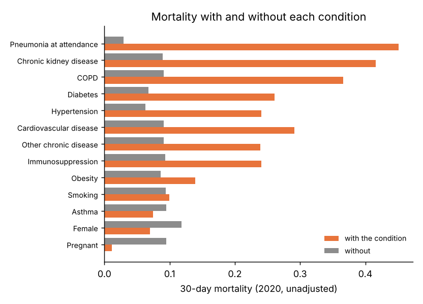
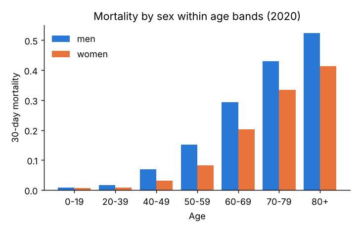
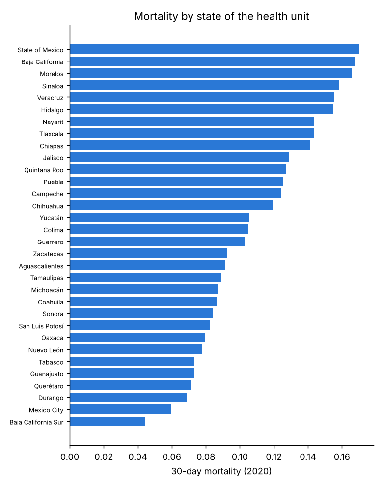
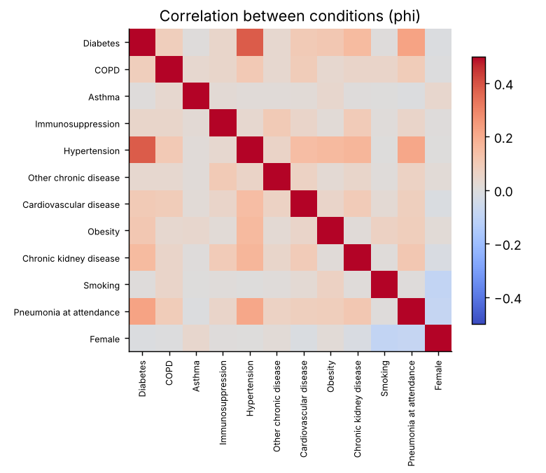
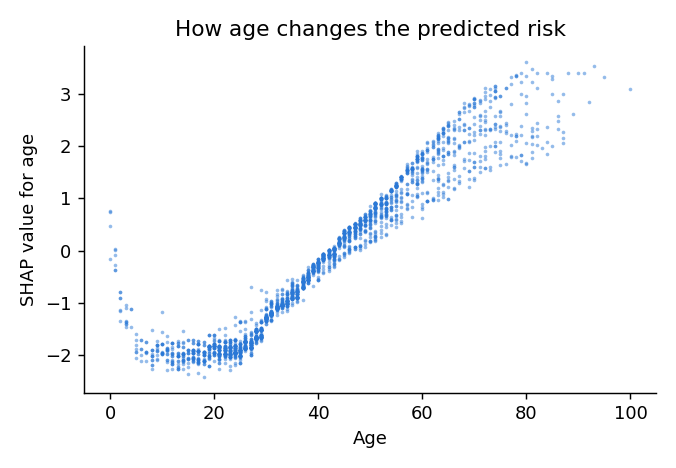

# Results (generated by `python -m covid_risk.report`; do not edit by hand)

## Cohort

| Step | Patients |
|---|---|
| records in the yearly files | 12,698,741 |
| confirmed or committee-classified (codes 1-3) | 4,089,784 |
| unique patients (latest version of each record) | 4,089,784 |
| confirmed COVID-19 (codes 1, 3); code 2 excluded (assigned only to deaths) | 4,074,247 |
| valid age, sex and attendance date | 4,073,940 |
| attended 2020-03-01..2021-11-30 with >= 30 days follow-up | 3,922,608 |
| death not dated before attendance | 3,922,386 |

| | Development (2020) | Test (2021) |
|---|---|---|
| Attended | 2020-03-01 to 2020-12-31 | 2021-01-01 to 2021-11-30 |
| Patients | 1,511,556 | 2,410,830 |
| 30-day deaths | 142,447 (9.4%) | 136,306 (5.7%) |
| Age, median (IQR) | 43 (31–55) | 37 (26–50) |
| Female | 49.6% | 50.7% |
| Pneumonia at attendance | 15.3% | 8.9% |
| Hospitalised | 20.2% | 12.2% |
| States | 32 | 32 |
| Diabetes | 13.8% | 9.2% |
| Copd | 1.2% | 0.7% |
| Asthma | 2.4% | 1.7% |
| Immunosuppression | 0.9% | 0.5% |
| Hypertension | 17.8% | 12.0% |
| Other disease | 2.0% | 1.4% |
| Cardiovascular | 1.7% | 0.9% |
| Obesity | 15.5% | 9.9% |
| Chronic kidney | 1.6% | 0.9% |
| Smoking | 7.5% | 6.0% |

## Data quality (raw confirmed records, before cleaning)

4,089,784 confirmed records checked. Counts are on confirmed records (codes 1-3) in the raw files, before de-duplication and exclusions. 'Missing' includes 98 (unknown) and 99 (not specified), and 97 (not applicable) where the field applies.

| Field | Records in scope | Missing / unknown | Share | Codes outside the catalogue |
|---|---|---|---|---|
| INTUBADO | 624,571 | 5,568 | 0.89% | 0 |
| UCI | 624,571 | 5,564 | 0.89% | 0 |
| OTRA_COM | 4,089,784 | 30,218 | 0.74% | 0 |
| EMBARAZO | 2,062,844 | 12,616 | 0.61% | 0 |
| NEUMONIA | 4,089,784 | 14,431 | 0.35% | 0 |
| DIABETES | 4,089,784 | 9,971 | 0.24% | 0 |
| TABAQUISMO | 4,089,784 | 9,690 | 0.24% | 0 |
| INMUSUPR | 4,089,784 | 9,394 | 0.23% | 0 |
| HIPERTENSION | 4,089,784 | 9,386 | 0.23% | 0 |
| CARDIOVASCULAR | 4,089,784 | 9,361 | 0.23% | 0 |
| EPOC | 4,089,784 | 9,328 | 0.23% | 0 |
| RENAL_CRONICA | 4,089,784 | 9,274 | 0.23% | 0 |
| ASMA | 4,089,784 | 9,183 | 0.22% | 0 |
| OBESIDAD | 4,089,784 | 8,838 | 0.22% | 0 |
| EDAD | 4,089,784 | 32 | 0.00% | 0 |
| SECTOR | 4,089,784 | 23 | 0.00% | 0 |
| SEXO | 4,089,784 | 0 | 0.00% | 0 |
| TIPO_PACIENTE | 4,089,784 | 0 | 0.00% | 0 |
| ENTIDAD_UM | 4,089,784 | 0 | 0.00% | 0 |
| FECHA_INGRESO | 4,089,784 | 0 | 0.00% | 0 |
| FECHA_SINTOMAS | 4,089,784 | 0 | 0.00% | 0 |

| Consistency / plausibility check | Records | Share |
|---|---|---|
| outpatient recorded in ICU | 0 | 0.000% |
| outpatient recorded as intubated | 0 | 0.000% |
| male recorded as pregnant | 0 | 0.000% |
| symptoms after attendance | 1 | 0.000% |
| symptoms > 30 days before attendance | 1,450 | 0.035% |
| attendance after file date | 0 | 0.000% |
| age over 110 | 307 | 0.008% |

Shift between 2020 (development) and 2021 (test): standardised mean difference (|SMD| > 0.1 is a notable shift).

| Feature | 2020 | 2021 | SMD |
|---|---|---|---|
| Age | 43.765 | 39.308 | -0.261 |
| Pneumonia at attendance | 0.153 | 0.089 | -0.200 |
| Days from symptoms to attendance | 4.078 | 3.459 | -0.196 |
| Obesity | 0.155 | 0.099 | -0.170 |
| Hypertension | 0.178 | 0.120 | -0.165 |
| Diabetes | 0.138 | 0.092 | -0.146 |
| died | 0.094 | 0.057 | -0.143 |
| Pneumonia not recorded | 0.000 | 0.006 | +0.106 |
| Cardiovascular disease | 0.017 | 0.009 | -0.068 |
| Chronic kidney disease | 0.016 | 0.009 | -0.059 |
| Smoking | 0.075 | 0.060 | -0.058 |
| COPD | 0.012 | 0.007 | -0.055 |
| Immunosuppression | 0.009 | 0.005 | -0.050 |
| Other chronic disease | 0.020 | 0.014 | -0.049 |
| Asthma | 0.024 | 0.017 | -0.047 |
| A comorbidity not recorded | 0.007 | 0.010 | +0.031 |
| Pregnant | 0.006 | 0.008 | +0.022 |
| Female | 0.496 | 0.507 | +0.022 |

## Exploratory analysis (2020 development data unless stated)

| Condition | Prevalence | Mortality with | Mortality without | Crude odds ratio (95% CI) | Median age with |
|---|---|---|---|---|---|
| Pneumonia at attendance | 15.3% | 45.1% | 3.0% | 26.85 (26.50–27.21) | 58 |
| Chronic kidney disease | 1.6% | 41.6% | 8.9% | 7.28 (7.09–7.48) | 58 |
| COPD | 1.2% | 36.6% | 9.1% | 5.77 (5.60–5.95) | 67 |
| Diabetes | 13.8% | 26.1% | 6.8% | 4.87 (4.81–4.93) | 58 |
| Hypertension | 17.8% | 24.0% | 6.3% | 4.75 (4.69–4.80) | 59 |
| Cardiovascular disease | 1.7% | 29.1% | 9.1% | 4.12 (4.00–4.23) | 62 |
| Other chronic disease | 2.0% | 23.9% | 9.1% | 3.13 (3.04–3.21) | 50 |
| Immunosuppression | 0.9% | 24.1% | 9.3% | 3.10 (2.98–3.22) | 52 |
| Obesity | 15.5% | 13.9% | 8.6% | 1.72 (1.70–1.74) | 46 |
| Smoking | 7.5% | 9.9% | 9.4% | 1.07 (1.05–1.09) | 40 |
| Asthma | 2.4% | 7.5% | 9.5% | 0.77 (0.74–0.80) | 40 |
| Female | 49.6% | 7.0% | 11.8% | 0.56 (0.55–0.56) | 42 |
| Pregnant | 0.6% | 1.1% | 9.5% | 0.11 (0.09–0.13) | 28 |

Crude odds ratios are confounded by age (most conditions are more common in older patients); adjusted odds ratios are in the Explanations section.

| Number of chronic conditions | Share of patients | 30-day mortality |
|---|---|---|
| 0 | 58.8% | 4.4% |
| 1 | 24.7% | 11.0% |
| 2 | 11.1% | 21.2% |
| 3 | 4.0% | 30.5% |
| 4+ | 1.3% | 39.8% |

| Age | Men | Women |
|---|---|---|
| 0-19 | 0.8% | 0.7% |
| 20-39 | 1.7% | 0.8% |
| 40-49 | 6.9% | 3.1% |
| 50-59 | 15.1% | 8.2% |
| 60-69 | 29.3% | 20.3% |
| 70-79 | 42.9% | 33.4% |
| 80+ | 52.3% | 41.4% |

| Age | Hospitalised | ICU | Intubated | 30-day mortality |
|---|---|---|---|---|
| 0-19 | 6.5% | 1.0% | 0.7% | 0.7% |
| 20-39 | 6.4% | 0.5% | 0.6% | 1.2% |
| 40-49 | 15.6% | 1.3% | 2.0% | 5.0% |
| 50-59 | 27.2% | 2.3% | 4.2% | 11.7% |
| 60-69 | 44.6% | 4.0% | 7.9% | 25.1% |
| 70-79 | 58.9% | 5.1% | 10.4% | 38.6% |
| 80+ | 65.7% | 5.5% | 9.6% | 47.3% |

| Health-care sector | Patients | 30-day mortality |
|---|---|---|
| SSA (Health Ministry) | 882,872 | 4.8% |
| IMSS | 453,365 | 17.0% |
| ISSSTE | 61,456 | 18.7% |
| Private | 48,869 | 5.7% |
| State | 21,305 | 10.8% |
| SEDENA | 12,084 | 19.5% |
| PEMEX | 11,804 | 16.6% |
| IMSS-Bienestar | 9,109 | 12.9% |
| SEMAR | 7,389 | 8.1% |
| Municipal | 1,233 | 6.2% |
| University | 1,220 | 17.9% |
| DIF | 687 | 0.0% |
| Red Cross | 162 | 11.7% |

Days from symptoms to attendance: median 4; mortality by delay: 0-2 days 7.5%, 3-5 days 8.2%, 6-9 days 12.9%, 10-30 days 15.8%.

Records with missing information: A comorbidity not recorded: 0.7% of patients, mortality 19.0% vs 9.4%; Pneumonia not recorded: 0.0% of patients, mortality 0.0% vs 9.4%. Missingness is kept as its own feature rather than imputed.

Largest correlation between two conditions: |phi| = 0.38 (no problematic overlap between predictors).

## Screening many model families (5-fold CV, development data only)

Sample of 100,000 patients; near-default settings. This replaces LazyPredict, which ranks models on the test set. The two strongest families are then tuned in the next step.

| Model | ROC-AUC | PR-AUC | Brier | Fit + predict time (5 folds) |
|---|---|---|---|---|
| Histogram gradient boosting | 0.9275 ± 0.0022 | 0.5516 ± 0.0111 | 0.0548 | 9s |
| Random forest | 0.9277 ± 0.0022 | 0.5510 ± 0.0091 | 0.0550 | 51s |
| Logistic regression | 0.9265 ± 0.0025 | 0.5499 ± 0.0097 | 0.0556 | 2s |
| LightGBM | 0.9267 ± 0.0021 | 0.5484 ± 0.0109 | 0.0551 | 15s |
| Neural network (MLP 32-16) | 0.9267 ± 0.0028 | 0.5460 ± 0.0082 | 0.0551 | 33s |
| AdaBoost | 0.9255 ± 0.0024 | 0.5441 ± 0.0111 | 0.1266 | 38s |
| Extra trees | 0.9256 ± 0.0025 | 0.5434 ± 0.0120 | 0.0556 | 45s |
| XGBoost | 0.9256 ± 0.0017 | 0.5390 ± 0.0141 | 0.0557 | 15s |
| LDA | 0.9248 ± 0.0025 | 0.5379 ± 0.0142 | 0.0736 | 2s |
| Decision tree (depth 8) | 0.9220 ± 0.0022 | 0.5342 ± 0.0085 | 0.0557 | 1s |
| k-nearest neighbours (k=100) | 0.9215 ± 0.0016 | 0.5299 ± 0.0080 | 0.0560 | 59s |
| Bernoulli naive Bayes | 0.8873 ± 0.0040 | 0.4550 ± 0.0130 | 0.0670 | 0s |
| QDA (regularised) | 0.8928 ± 0.0032 | 0.3649 ± 0.0151 | 0.1012 | 2s |
| Gaussian naive Bayes | 0.8888 ± 0.0033 | 0.3560 ± 0.0147 | 0.1080 | 0s |
| Prior only (no information) | 0.5000 ± 0.0000 | 0.0942 ± 0.0000 | 0.0854 | 0s |

## Model selection (development data, 5-fold cross-validation)

Stratified sample of 200,000 patients (death rate 9.4%). Tuned on 3 folds by PR-AUC: Logistic regression {'C': 10.0}; Gradient boosting {'learning_rate': 0.05, 'max_leaf_nodes': 15, 'min_samples_leaf': 100}.

| Model | Imbalance handling | ROC-AUC | PR-AUC | Brier | Calibration intercept | Calibration slope |
|---|---|---|---|---|---|---|
| Age only (baseline) | none | 0.8434 ± 0.0030 | 0.3433 ± 0.0090 | 0.0707 | +0.00 | 1.00 |
| Logistic regression | none | 0.9279 ± 0.0012 | 0.5564 ± 0.0078 | 0.0553 | -0.00 | 1.00 |
| Logistic regression | class weight | 0.9285 ± 0.0012 | 0.5543 ± 0.0078 | 0.1054 | -2.37 | 0.87 |
| Logistic regression | oversample | 0.9285 ± 0.0012 | 0.5542 ± 0.0077 | 0.1053 | -2.37 | 0.87 |
| Logistic regression | smote | 0.9280 ± 0.0012 | 0.5546 ± 0.0078 | 0.1049 | -2.36 | 0.87 |
| Gradient boosting | none | 0.9293 ± 0.0014 | 0.5590 ± 0.0061 | 0.0544 | +0.00 | 1.01 |
| Gradient boosting | class weight | 0.9294 ± 0.0014 | 0.5603 ± 0.0071 | 0.1105 | -2.24 | 1.01 |
| Gradient boosting | oversample | 0.9289 ± 0.0015 | 0.5572 ± 0.0088 | 0.1094 | -2.24 | 0.98 |
| Gradient boosting | smote | 0.9251 ± 0.0013 | 0.5455 ± 0.0106 | 0.0826 | -1.60 | 0.96 |

**Chosen:** Gradient boosting, imbalance handling: none, parameters {'learning_rate': 0.05, 'max_leaf_nodes': 15, 'min_samples_leaf': 100}. Rule: highest mean CV PR-AUC; imbalance correction only if significantly better than none (corrected t-test).

## Temporal validation: fitted on 2020, tested on 2021

Development: 1,511,556 patients. Test: 2,410,830 patients, 136,306 deaths (5.7%). ROC-AUC CI: DeLong; PR-AUC CI: bootstrap.

| Model | ROC-AUC | PR-AUC | Brier | ECE | Calibration intercept | Calibration slope |
|---|---|---|---|---|---|---|
| Age only (baseline) | 0.861 (0.860–0.862) | 0.276 (0.272–0.282) | 0.0462 | 0.0171 | -0.338 | 0.995 |
| Logistic regression | 0.946 (0.946–0.947) | 0.540 (0.533–0.548) | 0.0340 | 0.0115 | -0.091 | 1.096 |
| Gradient boosting | 0.949 (0.949–0.950) | 0.546 (0.539–0.553) | 0.0334 | 0.0043 | -0.049 | 1.070 |

Gradient boosting vs logistic, PR-AUC: +0.0055 (CI +0.0028 to +0.0084).

### Using the gradient boosting to prioritise patients (2021)

| Patients flagged (highest risk first) | Share of all deaths among them | Death rate among flagged | Risk cut-off |
|---|---|---|---|
| top 5% | 52.3% | 59.2% | 42.3% |
| top 10% | 78.1% | 44.2% | 17.9% |
| top 20% | 92.3% | 26.1% | 4.7% |
| top 30% | 96.3% | 18.2% | 1.7% |

| Risk threshold | Net benefit: model | Net benefit: prioritise everyone |
|---|---|---|
| 5% | 0.0445 | 0.0069 |
| 10% | 0.0388 | -0.0483 |
| 20% | 0.0304 | -0.1793 |
| 30% | 0.0232 | -0.3478 |

**Recalibration:** re-estimating only the intercept on 2021-01 (shift +0.136) changes calibration-in-the-large on later months from -0.110 to -0.247 (ECE 0.0045 → 0.0081).

| Month | Patients | Observed | Predicted | ROC-AUC |
|---|---|---|---|---|
| 2021-01 | 422,228 | 9.0% | 8.3% | 0.941 |
| 2021-02 | 194,510 | 9.0% | 8.7% | 0.943 |
| 2021-03 | 142,940 | 7.4% | 8.0% | 0.943 |
| 2021-04 | 93,529 | 6.6% | 7.1% | 0.943 |
| 2021-05 | 65,810 | 4.6% | 5.4% | 0.940 |
| 2021-06 | 107,085 | 3.2% | 3.7% | 0.937 |
| 2021-07 | 381,386 | 3.0% | 3.4% | 0.945 |
| 2021-08 | 522,687 | 4.3% | 4.4% | 0.948 |
| 2021-09 | 273,465 | 4.9% | 5.4% | 0.956 |
| 2021-10 | 124,753 | 5.0% | 5.9% | 0.958 |
| 2021-11 | 82,437 | 4.7% | 5.7% | 0.954 |

## Geographic validation: each state held out in turn (development data)

Sample of 400,000 patients; 32 states evaluated. ROC-AUC median 0.927 (IQR 0.914–0.942; range 0.872–0.962). Calibration slope median 1.03; calibration intercept range -0.46 to +0.39.

| State | Patients | Observed | Predicted | ROC-AUC (95% CI) | Calibration intercept |
|---|---|---|---|---|---|
| Aguascalientes | 4,720 | 9.0% | 8.7% | 0.914 (0.903–0.925) | +0.06 |
| Baja California | 9,494 | 17.0% | 14.7% | 0.909 (0.902–0.915) | +0.29 |
| Baja California Sur | 4,823 | 4.6% | 5.4% | 0.962 (0.954–0.970) | -0.28 |
| Campeche | 2,056 | 12.5% | 11.1% | 0.902 (0.884–0.921) | +0.21 |
| Coahuila | 14,091 | 8.7% | 6.9% | 0.903 (0.894–0.911) | +0.39 |
| Colima | 2,175 | 11.1% | 11.1% | 0.929 (0.916–0.941) | -0.01 |
| Chiapas | 2,120 | 13.6% | 11.7% | 0.897 (0.880–0.914) | +0.29 |
| Chihuahua | 10,341 | 12.1% | 10.4% | 0.925 (0.919–0.931) | +0.27 |
| Mexico City | 112,466 | 6.0% | 8.1% | 0.935 (0.932–0.937) | -0.46 |
| Durango | 6,899 | 6.9% | 5.7% | 0.937 (0.928–0.947) | +0.29 |
| Guanajuato | 22,901 | 7.2% | 7.5% | 0.933 (0.928–0.938) | -0.07 |
| Guerrero | 6,923 | 10.3% | 10.9% | 0.939 (0.932–0.946) | -0.10 |
| Hidalgo | 6,276 | 16.0% | 15.6% | 0.912 (0.904–0.919) | +0.05 |
| Jalisco | 14,368 | 12.9% | 10.7% | 0.907 (0.901–0.913) | +0.34 |
| State of Mexico | 25,749 | 16.7% | 15.0% | 0.872 (0.867–0.877) | +0.20 |
| Michoacán | 9,182 | 8.6% | 10.3% | 0.945 (0.938–0.952) | -0.32 |
| Morelos | 2,838 | 15.6% | 15.6% | 0.921 (0.910–0.931) | -0.00 |
| Nayarit | 2,054 | 16.0% | 15.8% | 0.934 (0.923–0.945) | +0.02 |
| Nuevo León | 22,459 | 7.6% | 8.1% | 0.955 (0.951–0.959) | -0.11 |
| Oaxaca | 7,700 | 7.6% | 7.9% | 0.958 (0.951–0.965) | -0.05 |
| Puebla | 13,792 | 12.5% | 13.0% | 0.925 (0.920–0.931) | -0.07 |
| Querétaro | 9,348 | 7.1% | 8.8% | 0.957 (0.952–0.963) | -0.35 |
| Quintana Roo | 4,285 | 13.3% | 11.0% | 0.949 (0.941–0.957) | +0.37 |
| San Luis Potosí | 11,095 | 8.3% | 9.1% | 0.960 (0.954–0.965) | -0.15 |
| Sinaloa | 7,269 | 16.1% | 14.2% | 0.915 (0.908–0.923) | +0.25 |
| Sonora | 14,808 | 8.2% | 8.5% | 0.949 (0.944–0.954) | -0.05 |
| Tabasco | 11,787 | 7.3% | 8.0% | 0.942 (0.935–0.948) | -0.14 |
| Tamaulipas | 10,992 | 9.1% | 7.4% | 0.924 (0.916–0.932) | +0.34 |
| Tlaxcala | 2,737 | 13.9% | 13.2% | 0.918 (0.904–0.931) | +0.10 |
| Veracruz | 11,399 | 15.7% | 13.3% | 0.892 (0.885–0.899) | +0.31 |
| Yucatán | 7,127 | 10.6% | 8.8% | 0.932 (0.924–0.940) | +0.35 |
| Zacatecas | 5,726 | 9.4% | 7.9% | 0.922 (0.912–0.932) | +0.30 |

## Monitoring: rolling monthly recalibration (2021)

Each month, only the calibration intercept is re-estimated on the previous month's outcomes and applied to the current month (no refitting, no look-ahead). Computed on the published stratified sample of 2021 predictions (test_predictions_sample.csv.gz) (200,000 patients). Ranking (ROC-AUC) is unchanged by construction.

Months 2-11: calibration-in-the-large -0.103 → -0.031; ECE 0.0045 → 0.0038; mean predicted 5.27% → 5.04% (observed 4.94%).

| Month | Observed | Predicted (2020 model) | Predicted after rolling update |
|---|---|---|---|
| 2021-01 | 9.0% | 8.4% | 8.4% |
| 2021-02 | 8.8% | 8.6% | 9.2% |
| 2021-03 | 7.5% | 7.9% | 8.1% |
| 2021-04 | 6.1% | 7.0% | 6.7% |
| 2021-05 | 5.1% | 5.6% | 4.8% |
| 2021-06 | 3.1% | 3.6% | 3.3% |
| 2021-07 | 3.2% | 3.4% | 3.0% |
| 2021-08 | 4.3% | 4.3% | 4.0% |
| 2021-09 | 5.0% | 5.5% | 5.5% |
| 2021-10 | 5.0% | 6.1% | 5.5% |
| 2021-11 | 4.2% | 5.4% | 4.4% |

## Leakage check (2021 test)

| Model | ROC-AUC | PR-AUC | ROC-AUC change vs triage model |
|---|---|---|---|
| Triage features only (deployable) | 0.9491 | – | – |
| + hospitalised | 0.9779 | 0.6241 | +0.0287 (p <1e-300) |
| + hospitalised, ICU, intubated | 0.9802 | 0.6858 | +0.0310 (p <1e-300) |

## Subgroups (2021 test)

| Group | Patients | Deaths | Observed | Predicted | ROC-AUC (95% CI) |
|---|---|---|---|---|---|
| sex: female | 1,223,002 | 54,767 | 4.5% | 4.5% | 0.953 (0.952–0.953) |
| sex: male | 1,187,828 | 81,539 | 6.9% | 7.2% | 0.945 (0.944–0.945) |
| age: 0-39 | 1,330,454 | 10,779 | 0.8% | 0.7% | 0.939 (0.936–0.942) |
| age: 40-59 | 753,370 | 42,263 | 5.6% | 5.5% | 0.906 (0.905–0.908) |
| age: 60-79 | 281,574 | 64,907 | 23.1% | 24.7% | 0.845 (0.844–0.847) |
| age: 80+ | 45,432 | 18,357 | 40.4% | 43.4% | 0.780 (0.776–0.785) |
| sector: IMSS | 1,063,870 | 72,805 | 6.8% | 5.5% | 0.945 (0.944–0.945) |
| sector: ISSSTE | 58,766 | 10,494 | 17.9% | 17.9% | 0.913 (0.910–0.915) |
| sector: Other | 45,572 | 5,695 | 12.5% | 13.4% | 0.904 (0.900–0.907) |
| sector: Private | 64,737 | 2,650 | 4.1% | 8.3% | 0.951 (0.948–0.954) |
| sector: SSA (Health Ministry) | 1,155,029 | 42,916 | 3.7% | 5.0% | 0.964 (0.963–0.965) |
| sector: State | 22,856 | 1,746 | 7.6% | 9.1% | 0.927 (0.921–0.933) |
| pneumonia: no pneumonia | 2,197,288 | 38,317 | 1.7% | 2.2% | 0.902 (0.901–0.904) |
| pneumonia: pneumonia | 213,542 | 97,989 | 45.9% | 43.1% | 0.705 (0.703–0.707) |

## Explanations

Model explained: Gradient boosting (the chosen model). Method: shap.TreeExplainer 0.52.0; additivity check max error 3.9e-14.

| Feature | Mean \|SHAP\| (log-odds) |
|---|---|
| Age | 1.2601 |
| Pneumonia at attendance | 0.7413 |
| Female | 0.3450 |
| Days from symptoms to attendance | 0.1996 |
| Diabetes | 0.1746 |
| Hypertension | 0.1247 |
| Obesity | 0.1218 |
| Smoking | 0.0467 |
| Other chronic disease | 0.0409 |
| Chronic kidney disease | 0.0327 |
| Immunosuppression | 0.0135 |
| A comorbidity not recorded | 0.0112 |
| COPD | 0.0082 |
| Cardiovascular disease | 0.0052 |
| Asthma | 0.0037 |
| Pregnant | 0.0002 |
| Pneumonia not recorded | 0.0000 |

Adjusted odds ratios (unpenalised logistic regression, 200,000 development patients; Holm-adjusted p):

| Factor | Odds ratio (95% CI) | p (Holm) |
|---|---|---|
| Pneumonia at attendance | 13.23 (12.72–13.76) | <1e-300 |
| Chronic kidney disease | 2.79 (2.53–3.07) | 8.7e-94 |
| Age (per 10 years) | 1.84 (1.82–1.87) | <1e-300 |
| Other chronic disease | 1.75 (1.58–1.93) | 2.7e-26 |
| Diabetes | 1.54 (1.47–1.61) | 9.5e-82 |
| A comorbidity not recorded | 1.51 (1.27–1.80) | 2.7e-05 |
| Immunosuppression | 1.42 (1.23–1.64) | 1.1e-05 |
| Obesity | 1.39 (1.33–1.46) | 3.6e-42 |
| Hypertension | 1.24 (1.19–1.30) | 5.5e-21 |
| COPD | 1.22 (1.09–1.36) | 0.0025 |
| Pregnant | 1.18 (0.73–1.91) | 1 |
| Days from symptoms to attendance | 1.00 (1.00–1.01) | 0.53 |
| Cardiovascular disease | 0.94 (0.85–1.04) | 0.67 |
| Smoking | 0.90 (0.83–0.97) | 0.024 |
| Asthma | 0.85 (0.74–0.97) | 0.094 |
| Female | 0.61 (0.59–0.64) | 4.5e-129 |
| Pneumonia not recorded | not estimable (no such patients in the sample) | – |

## Hypothesis tests (Holm-adjusted across this table)

| # | Hypothesis | Evidence | p (Holm) | Verdict |
|---|---|---|---|---|
| H1 | Triage features add to age alone (logistic vs age-only, 2021 test) | ROC-AUC +0.085 (CI +0.084 to +0.086) | <1e-300 | supported |
| H2 | Gradient boosting beats logistic regression (2021 test) | ROC-AUC +0.003 (CI +0.003 to +0.003) | <1e-300 | supported |
| H3a | Class weight improves PR-AUC (gradient boosting, 5-fold CV) | PR-AUC +0.0013; calibration slope 1.01 | 0.82 | not supported |
| H3b | Oversample improves PR-AUC (gradient boosting, 5-fold CV) | PR-AUC -0.0018; calibration slope 0.98 | 0.82 | not supported |
| H3c | Smote improves PR-AUC (gradient boosting, 5-fold CV) | PR-AUC -0.0135; calibration slope 0.96 | 0.089 | not supported |
| H4 | Calibration drifts from 2020 to 2021 (calibration-in-the-large ≠ 0) | intercept -0.049; predicted 5.8% vs observed 5.7% | 9.5e-45 | supported |
| H5 | Post-triage variables (hospitalisation, ICU, intubation) inflate ROC-AUC | 0.980 vs 0.949 (+0.031) | <1e-300 | supported |
| H6 | Discrimination differs between women and men | ROC-AUC difference (F − M) +0.008 | 7.7e-49 | supported |

With millions of patients, very small differences reach statistical significance. Judge each supported hypothesis by the size of its effect in the Evidence column, not by the p-value alone.
